# TG Assistant

**Українська** | [English](README_EN.md)

Приватний Telegram-асистент на одному n8n-воркфлоу: керує Google Tasks, Google Calendar, Gmail і профілем користувача через текстові та голосові повідомлення.

Пишеш або наговорюєш у Telegram щось на кшталт «нагадай завтра о 18:00 купити молоко». Агент на OpenAI розбирає запит, викликає потрібний інструмент Google чи PostgreSQL і відповідає в тому ж чаті. Голосові спершу розпізнаються в текст, тому обидва типи повідомлень потрапляють до одного агента. Бот відповідає лише власнику, а перед надсиланням листа завжди питає підтвердження.

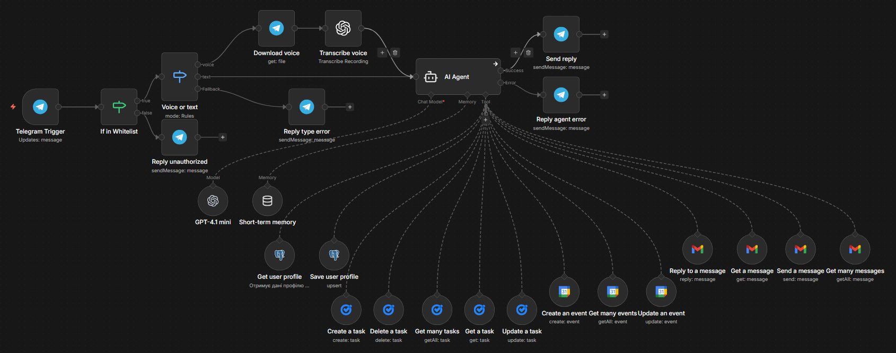

*Увесь воркфлоу: зліва тригер і перевірка доступу, посередині AI Agent, під ним 14 інструментів, справа відповідь і повідомлення про помилку.*

## Демо

### Текстове повідомлення

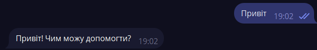
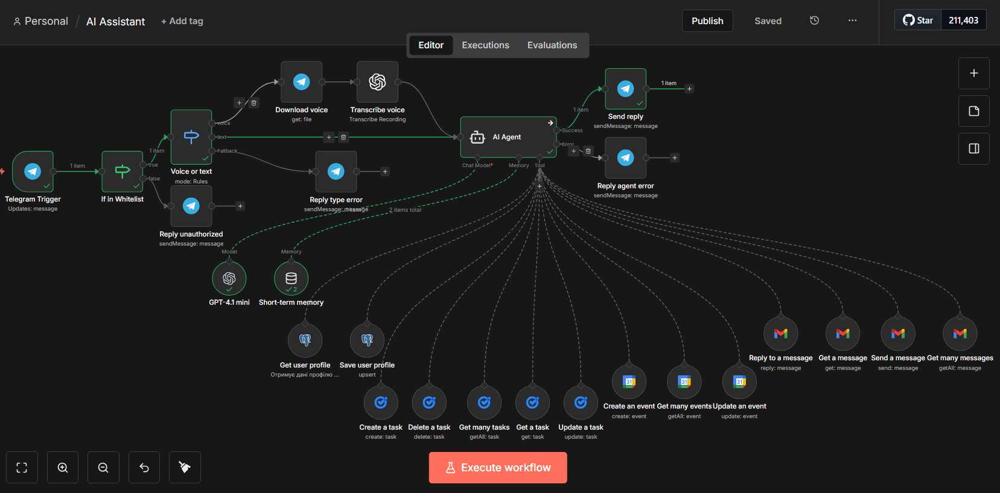

Звичайне привітання йде зі Switch прямо до агента. Агент відповідає без жодного інструмента.

### Голосове повідомлення

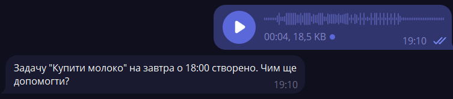
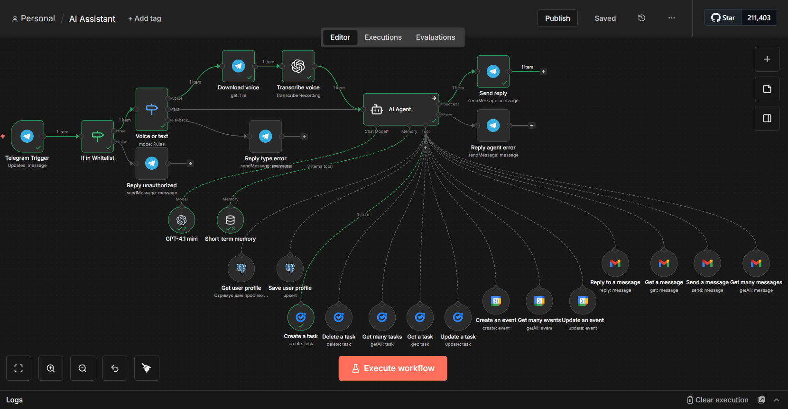

Голосове на 4 секунди перетворюється на задачу в Google Tasks «Купити молоко» на завтра о 18:00. Виконання проходить через Download voice, Transcribe voice, AI Agent і Create a task.

### Голосове + короткострокова пам'ять

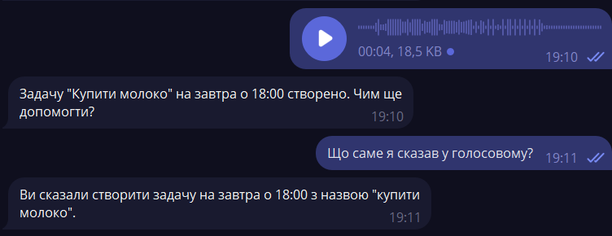
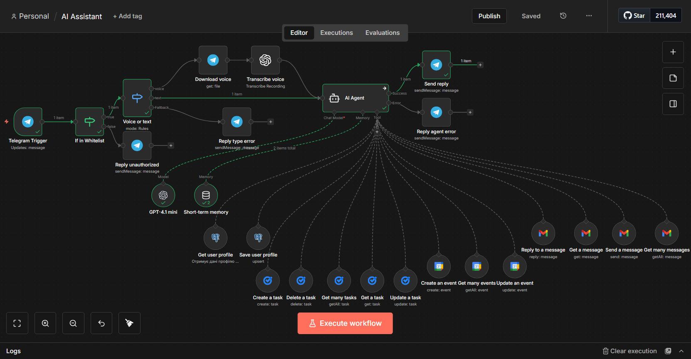

На питання «Що саме я сказав у голосовому?» агент відповідає з пам'яті чату, інструменти не викликаються.

### Календар

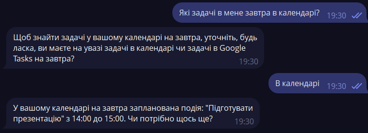
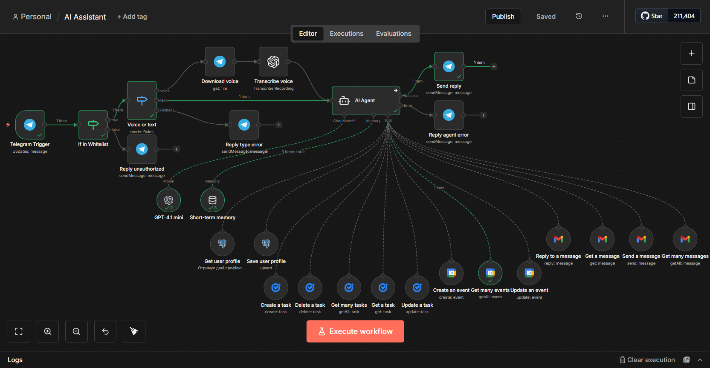

Запит «Які задачі в мене завтра в календарі?» можна зрозуміти і як Calendar, і як Tasks. Агент ставить одне уточнювальне запитання, а потім показує подію через Get many events.

### Лист із підтвердженням

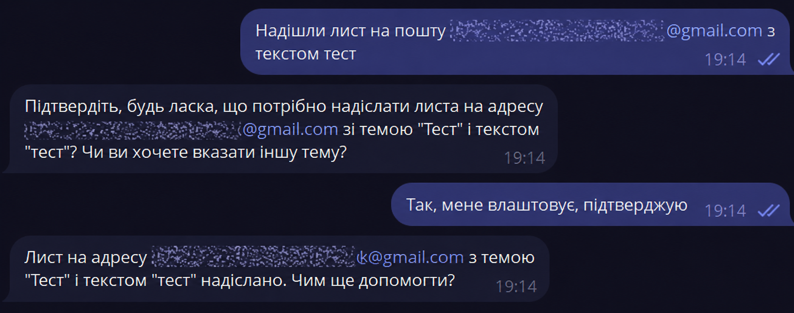

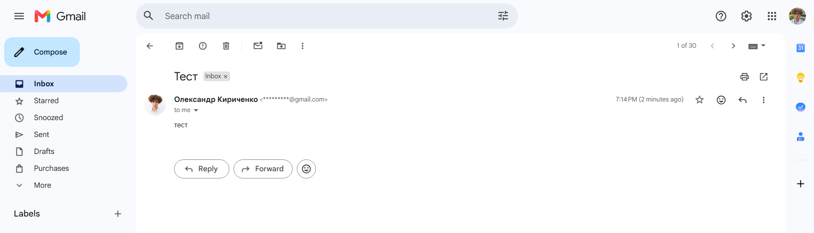

Агент показує адресата, тему й текст, чекає на «Так, підтверджую» і тільки тоді викликає Send a message. На останньому скріншоті лист уже в Gmail.

### Профіль користувача в PostgreSQL

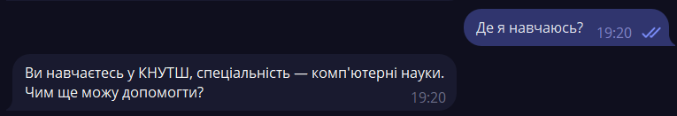
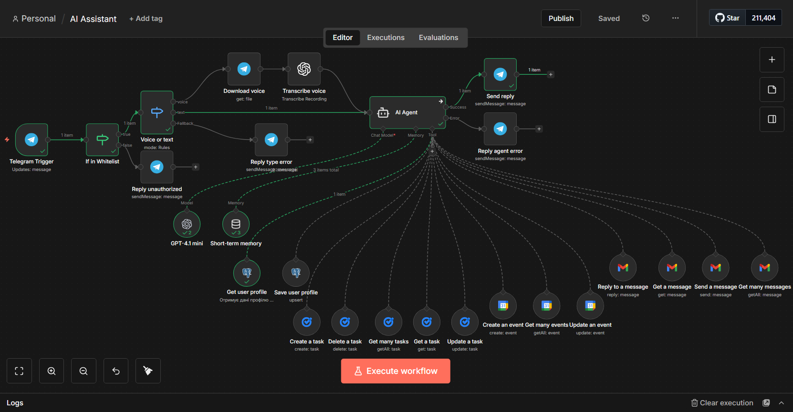
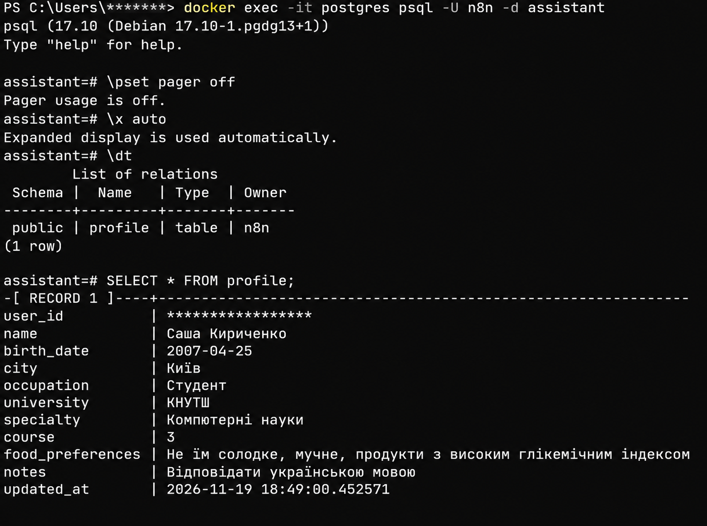

На «Де я навчаюсь?» агент відповідає з таблиці `profile` через Get user profile. Вивід psql показує весь рядок, з якого він читає.

### Непідтримуваний тип повідомлення

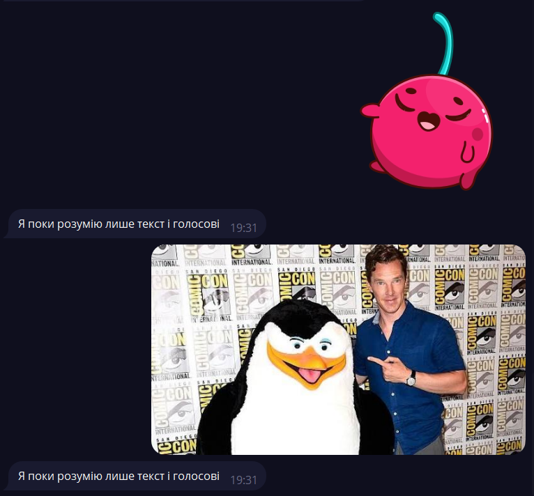


Стікер і фото йдуть у fallback-вихід Switch. Бот відповідає «Я поки розумію лише текст і голосові», а OpenAI навіть не викликається.

## Можливості

- Текст і голос. Голосові завантажуються з Telegram і розпізнаються OpenAI з мовою `uk`.
- Google Tasks: створити, показати список, отримати, оновити (зокрема позначити виконаною) і видалити задачу в одному списку.
- Google Calendar: створити, показати й оновити події в одному календарі. Якщо час завершення не вказано, подія триває годину.
- Gmail: пошук (до 15 результатів), читання, відповідь і надсилання.
- Профіль у PostgreSQL: місто, зайнятість, університет, спеціальність, курс, харчові вподобання, нотатки. Агент дивиться в профіль, перш ніж питати щось особисте, і записує туди лише на пряме прохання.
- Короткострокова пам'ять чату для кожного користувача Telegram, щоб уточнення й підтвердження не губили контекст.
- Пошук в інтернеті через вбудований web search моделі OpenAI.
- Усі дати в `Europe/Kyiv`. Поточні дата, день тижня й час підставляються в системний промпт при кожному запуску, тому «завтра» чи «в п'ятницю» перетворюються на конкретні дати.

## Архітектура

Кожне повідомлення з Telegram потрапляє в тригер, а потім в IF-ноду, яка порівнює ID відправника з ID власника. Усі інші отримують «Це приватний бот», і на цьому виконання завершується. Повідомлення власника йдуть у Switch з трьома виходами: голос, текст і fallback для всього іншого.

Голосове проходить завантаження й розпізнавання, текст іде напряму, і обидва потрапляють в один AI Agent. Агент працює на `gpt-4.1-mini` і може зробити до 8 викликів інструментів на одне повідомлення. Інструментів 14: 5 для Google Tasks, 3 для Calendar, 4 для Gmail і 2 для Postgres. Більшість параметрів інструментів модель заповнює через `$fromAI()`, і кожен параметр має власну коротку інструкцію. Telegram ID для запиту до бази береться з тригера, а не від моделі.

Успішний вихід агента надсилає відповідь у чат. Вихід помилки надсилає «Щось пішло не так, спробуй ще раз».

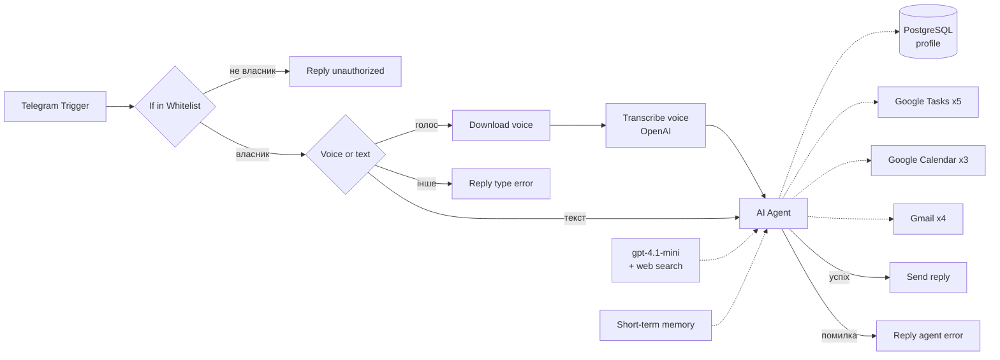

Суцільні стрілки показують шлях виконання. Пунктирні: модель, пам'ять та інструменти, підключені до агента.

## Безпека і надійність

- **Доступ лише для власника.** `If in Whitelist` звіряє `message.from.id` з `YOUR_TELEGRAM_USER_ID` до будь-яких інших дій. Сторонні користувачі не доходять ні до OpenAI, ні до інструментів Google.
- **Лист тільки після підтвердження.** Системний промпт вимагає показати адресата й текст і надсилати або відповідати лише після явного «так». Цей діалог видно на скріншоті з листом.
- **Вміст листів це дані.** Промпт забороняє виконувати інструкції з тексту листів, навіть якщо вони звернені до агента. Це основний захист від prompt injection через вхідну пошту.
- **Відповідь на непідтримувані повідомлення.** Фото, стікери, документи тощо йдуть у fallback Switch і отримують фіксовану відповідь, а не мовчання.
- **Відповідь на помилку агента.** У ноді AI Agent увімкнено «continue with error output», тож якщо запуск впаде, користувач отримає коротке повідомлення про помилку.
- **Оновлення не чіпають інші поля.** Перед оновленням задачі, події чи профілю агент має отримати поточний запис і передати назад усі поля, які користувач не просив змінювати. В описах полів інструмента оновлення календаря це повторено. На скріншоті з psql видно рядок профілю, де всі колонки заповнені.
- **Видалення задачі після підтвердження.** Агент спершу називає задачу і видаляє її лише після згоди.

## Як розширювати

- **Нова можливість це одна нода-інструмент.** Щоб додати, наприклад, пошук у Google Drive, треба поставити Google Drive Tool на полотно, під'єднати до входу Tool агента й дописати в системний промпт один рядок про те, коли ним користуватися. Решта воркфлоу не змінюється.
- **Модель це окрема нода.** `GPT-4.1 mini` винесено в окрему суб-ноду. Щоб перейти на іншу модель OpenAI чи іншого провайдера, досить замінити цю ноду, інструменти й промпт лишаються як є.
- **Поведінка задається текстом.** Системний промпт і всі описи `$fromAI()` це звичайні текстові поля в редакторі n8n. Змінити, як генеруються назви задач чи коли ставити уточнювальне запитання, можна без коду.
- **Більше користувачів = більше умов.** Allowlist це одна умова в IF. Для другого користувача додається ще одна умова через OR або перевірка за списком ID. Таблиця профілю й пам'ять чату вже прив'язані до Telegram ID. Інструменти Google при цьому працюють з акаунтом власника.
- **Інші типи вводу за тим самим принципом.** Fallback-вихід Switch показує, куди ставити нову гілку, наприклад для фото через модель, що розуміє зображення, перед агентом.

## Технології

- n8n (AI Agent і LangChain-ноди), self-hosted
- OpenAI: `gpt-4.1-mini` з web search, розпізнавання аудіо
- Telegram Bot API
- Google Tasks, Google Calendar і Gmail API через OAuth2
- PostgreSQL 17 (у мене в Docker)

## Налаштування

### 1. Зробити n8n доступним по HTTPS

Telegram Trigger реєструє вебхук, а Telegram звертається тільки на HTTPS-адреси. На локальній машині запусти тунель, наприклад `ngrok http 5678`, і стартуй n8n з `WEBHOOK_URL=https://<your-subdomain>.ngrok-free.app/`. На сервері використовуй свій домен.

### 2. Імпортувати воркфлоу

У n8n: **Workflows > Import from File** і вибрати `AI Assistant.json`.

### 3. Створити облікові дані

| Credential | Ноди | Де взяти |
|---|---|---|
| Telegram API | Telegram Trigger, Download voice, усі ноди відповіді | Токен бота від [@BotFather](https://t.me/BotFather) |
| OpenAI API | GPT-4.1 mini, Transcribe voice | API-ключ на platform.openai.com |
| Google Tasks OAuth2 API | 5 нод задач | OAuth-клієнт у Google Cloud з увімкненим Tasks API |
| Google Calendar OAuth2 API | 3 ноди календаря | Той самий клієнт, увімкнений Calendar API |
| Gmail OAuth2 | 4 ноди Gmail | Той самий клієнт, увімкнений Gmail API |
| Postgres | Get user profile, Save user profile | Хост, база, користувач і пароль твого Postgres |

Потім відкрий кожну ноду й вибери відповідний credential.

### 4. Створити таблицю профілю

Ноди Postgres читають і роблять upsert у `public.profile` за `user_id`. Ця схема відповідає колонкам у воркфлоу:

```sql
CREATE TABLE public.profile (
    user_id          BIGINT PRIMARY KEY,  -- Telegram user ID
    name             TEXT,
    birth_date       DATE,
    city             TEXT,
    occupation       TEXT,
    university       TEXT,
    specialty        TEXT,
    course           INTEGER,
    food_preferences TEXT,
    notes            TEXT,
    updated_at       TIMESTAMP DEFAULT now()
);
```

Save user profile записує `city`, `occupation`, `university`, `specialty`, `course`, `food_preferences` і `notes`. `name` і `birth_date` агент може лише читати, тож якщо хочеш, щоб бот їх знав, заповни їх через SQL.

### 5. Замінити плейсхолдери

| Плейсхолдер | Ноди | Значення |
|---|---|---|
| `YOUR_TELEGRAM_USER_ID` | If in Whitelist | Твій числовий Telegram ID. Напиши будь-що боту [@userinfobot](https://t.me/userinfobot), і він його покаже |
| `YOUR_GOOGLE_TASKLIST_ID` | Create / Delete / Get many / Get / Update a task | Вибери свій список задач у випадаючому меню кожної ноди |
| `YOUR_GOOGLE_CALENDAR_ID@group.calendar.google.com`, `YOUR_CALENDAR_NAME` | Create an event, Get many events, Update an event | Вибери календар у випадаючому меню, обидва значення заміняться |
| `YOUR_N8N_INSTANCE_ID` | `meta` воркфлоу | Нічого робити не треба, n8n проставить його при імпорті |

### 6. Активувати

Збережи, увімкни воркфлоу і напиши боту з акаунта, чий ID вказано в allowlist.

## Обмеження

- Від prompt injection захищає тільки системний промпт. Добре складений лист усе ще може його обійти, а поза моделлю перед запуском Send a message немає жодної перевірки.
- Save user profile робить upsert одразу всіх семи колонок. Якщо модель пропустить поле замість того, щоб передати його поточне значення, колонку може бути перезаписано порожнім значенням.
- Воркфлоу не оновлює `updated_at`. Колонка отримує `now()` лише при вставці рядка. Щоб вона оновлювалась, потрібен тригер у Postgres.
- Видаляти події в календарі не можна: інструмента для цього немає, і агент так і відповідає.
- Усе працює на моєму комп'ютері (n8n і Postgres локально, вебхук через тунель), тож коли комп'ютер вимкнено, бот теж не працює. Короткострокова пам'ять живе в процесі n8n і зникає після перезапуску.
