# TG Assistant

[Українська](README.md) | **English**

A private Telegram assistant built as a single n8n workflow that manages Google Tasks, Google Calendar, Gmail and a personal profile from text or voice messages.

You write or say something like "remind me to buy milk tomorrow at 6 PM" in Telegram. An OpenAI agent works out what you mean, calls the right Google or PostgreSQL tool and answers in the same chat. Voice notes are transcribed first, so both inputs go through the same agent. The bot only answers its owner, and it asks before sending any email.

The assistant talks in Ukrainian (the system prompt and transcription are set to it), so the screenshots below are in Ukrainian with English captions.

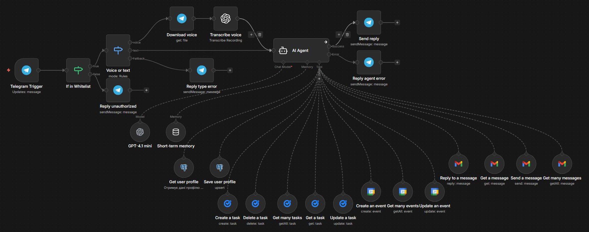

*The whole workflow: trigger and allowlist on the left, the AI Agent in the middle, its 14 tools along the bottom, reply and error reply on the right.*

## Demo

### Text message

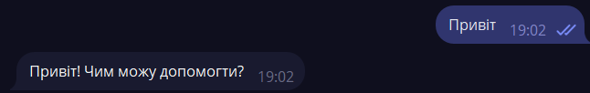
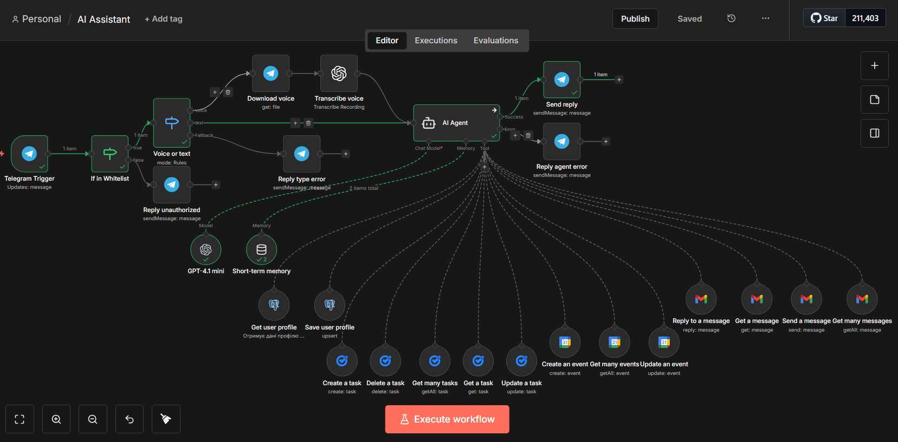

A plain text greeting goes straight from the Switch to the agent, and the agent replies without calling any tool.

### Voice message

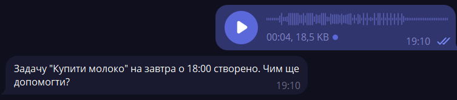
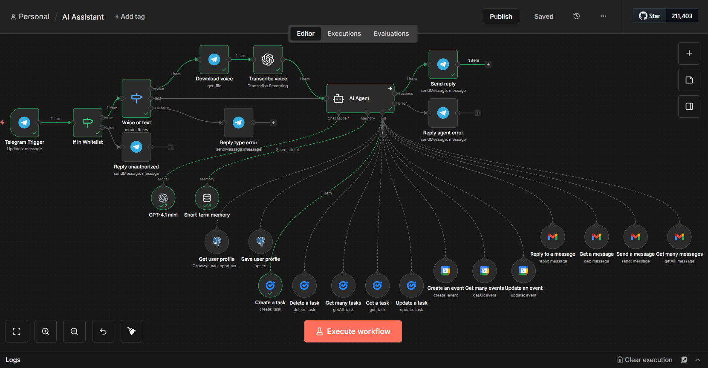

A 4-second voice note becomes a Google Task "Купити молоко" ("Buy milk") due tomorrow at 18:00. The execution goes through Download voice, Transcribe voice, AI Agent and Create a task.

### Voice + short-term memory

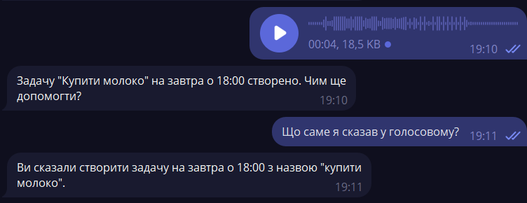
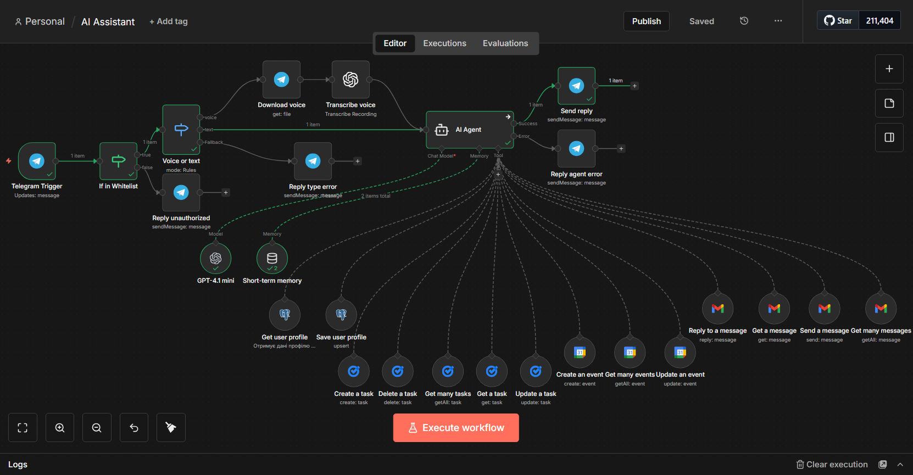

The follow-up "what exactly did I say in the voice message?" is answered from chat memory, with no tool call.

### Calendar

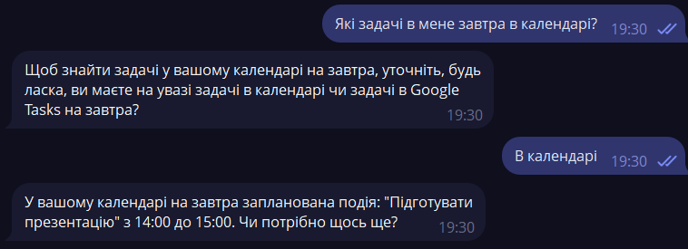
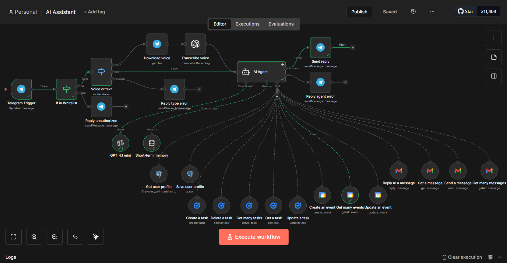

"What's on my calendar tomorrow?" is ambiguous between Calendar and Tasks, so the agent asks one clarifying question, then lists the event through Get many events.

### Email with confirmation

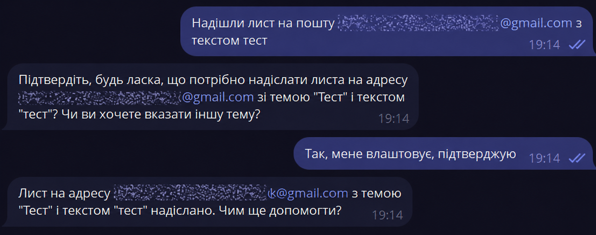

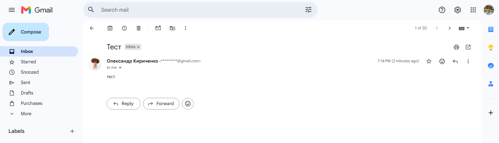

The agent shows the recipient, subject and text, waits for "yes, I confirm", and only then calls Send a message. The last screenshot is the email arriving in Gmail.

### User profile in PostgreSQL

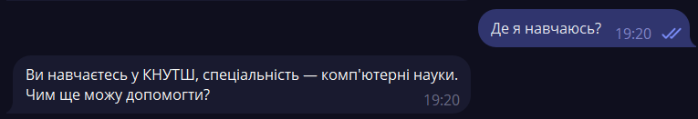
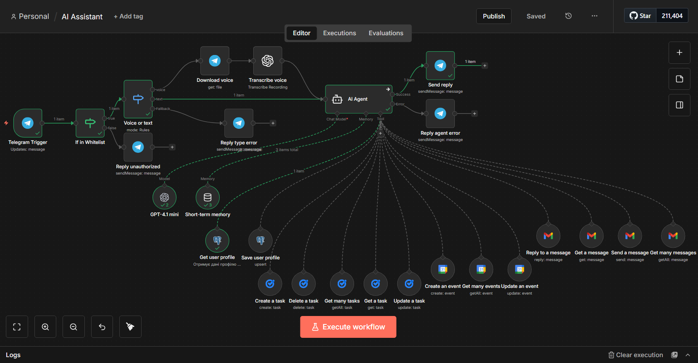
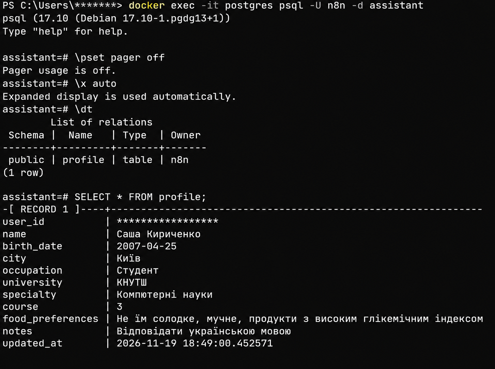

"Where do I study?" is answered from the `profile` table through Get user profile. The psql output shows the full row the agent reads from.

### Unsupported input

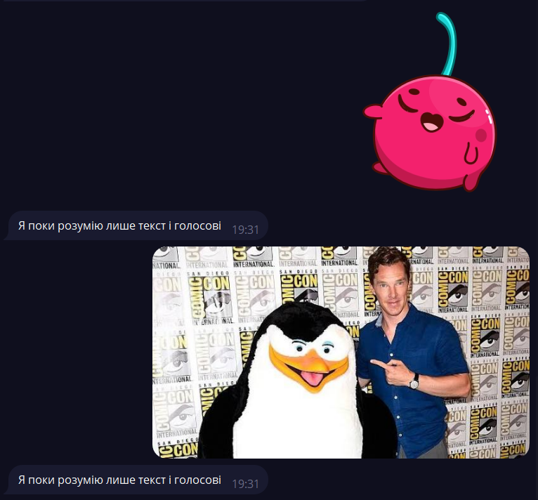


A sticker and a photo go to the Switch fallback output, and the bot replies "I only understand text and voice for now" without calling OpenAI.

## Features

- Text and voice input. Voice notes are downloaded from Telegram and transcribed by OpenAI with the language set to Ukrainian.
- Google Tasks: create, list, get, update (including marking done) and delete tasks in one task list.
- Google Calendar: create, list and update events in one calendar. Events without an end time get one hour.
- Gmail: search (up to 15 results), read, reply and send.
- A user profile in PostgreSQL (city, occupation, university, specialty, course, food preferences, notes). The agent reads it before asking personal questions and writes to it only when asked to remember something.
- Short-term chat memory per Telegram user, so follow-up questions and confirmations keep their context.
- Web search through the OpenAI model's built-in search tool.
- All dates are in `Europe/Kyiv`. The current date, weekday and time are inserted into the system prompt on every run, so "tomorrow" or "on Friday" resolve to real dates.

## Architecture

Every Telegram message hits the trigger, then an IF node that compares the sender's ID with the owner's. Everyone else gets "this is a private bot" and the run ends. The owner's messages go to a Switch with three outputs: voice, text, and a fallback for everything else.

Voice goes through download and transcription, text goes straight on, and both reach the same AI Agent. The agent runs on `gpt-4.1-mini` with up to 8 tool calls per message. Its tools are 5 Google Tasks nodes, 3 Calendar nodes, 4 Gmail nodes and 2 Postgres nodes. Most tool parameters are filled by the model through `$fromAI()`, and each parameter has its own short instruction. The Telegram user ID for the database query is read from the trigger, not from the model.

The agent's success output sends its answer back to the chat. Its error output sends "something went wrong, try again".

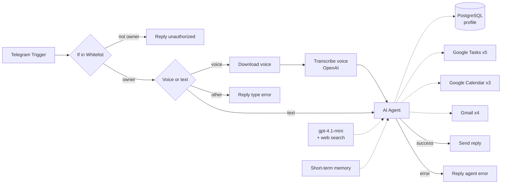

Solid arrows are the execution path. Dotted arrows are the model, memory and tools attached to the agent.

## Security and reliability

- **Owner-only access.** `If in Whitelist` checks `message.from.id` against `YOUR_TELEGRAM_USER_ID` before anything else runs. Other users never reach OpenAI or the Google tools.
- **Email needs confirmation.** The system prompt requires the agent to show the recipient and text and to send or reply only after an explicit "yes". The email screenshot above shows this exchange.
- **Email content is data.** The prompt tells the agent never to follow instructions found inside emails, even ones addressed to it. This is the main defence against prompt injection through incoming mail.
- **Unsupported messages get an answer.** Photos, stickers, documents and the rest go to the Switch fallback and get a fixed reply instead of failing silently.
- **Agent errors get an answer.** The AI Agent node uses n8n's "continue with error output", so a failed run sends a short error message to the chat instead of leaving the user waiting.
- **Updates keep unchanged fields.** Before updating a task, event or profile, the agent is told to fetch the current record and pass back every field the user did not ask to change. The calendar update tool repeats this in its field descriptions. The psql screenshot shows a profile row with every column still filled.
- **Deleting a task needs confirmation.** The agent names the task first and deletes it only after you agree.

## Easy to extend

- **New capability = one tool node.** To add, say, Google Drive search, you drop a Google Drive Tool node on the canvas, connect it to the agent's Tool input and add one line about when to use it to the system prompt. The rest of the flow stays the same.
- **The model is one node.** `GPT-4.1 mini` is a separate sub-node. Swapping it for another OpenAI model, or another provider's chat model node, means replacing that node without touching the tools or prompt.
- **Behaviour is plain text.** The system prompt and every `$fromAI()` description are text fields in the n8n editor. Changing how titles are generated or when to ask for clarification doesn't involve any code.
- **More users = more conditions.** The allowlist is one IF condition. Adding a second user means adding another condition with OR, or replacing it with a check against a list of IDs. The profile table and chat memory are already keyed by Telegram user ID. The Google tools still use the owner's account.
- **Other input types follow the same pattern.** The Switch fallback marks where a new branch goes, for example photos through an image-capable model before the agent.

## Tech stack

- n8n (AI Agent and LangChain nodes), self-hosted
- OpenAI: `gpt-4.1-mini` with web search, audio transcription
- Telegram Bot API
- Google Tasks, Google Calendar and Gmail APIs over OAuth2
- PostgreSQL 17 (in Docker in my setup)

## Setup

### 1. Make n8n reachable over HTTPS

The Telegram Trigger registers a webhook, and Telegram only calls HTTPS URLs. On a local machine, run a tunnel such as `ngrok http 5678` and start n8n with `WEBHOOK_URL=https://<your-subdomain>.ngrok-free.app/`. On a server, use your domain.

### 2. Import the workflow

In n8n: **Workflows > Import from File** and pick `AI Assistant.json`.

### 3. Create credentials

| Credential | Nodes | Where to get it |
|---|---|---|
| Telegram API | Telegram Trigger, Download voice, all reply nodes | Bot token from [@BotFather](https://t.me/BotFather) |
| OpenAI API | GPT-4.1 mini, Transcribe voice | API key from platform.openai.com |
| Google Tasks OAuth2 API | 5 task tools | Google Cloud OAuth client with the Tasks API enabled |
| Google Calendar OAuth2 API | 3 calendar tools | Same client, Calendar API enabled |
| Gmail OAuth2 | 4 Gmail tools | Same client, Gmail API enabled |
| Postgres | Get user profile, Save user profile | Host, database, user and password of your Postgres |

Open each node and select the matching credential.

### 4. Create the profile table

The Postgres nodes read and upsert `public.profile` by `user_id`. This schema matches the columns in the workflow:

```sql
CREATE TABLE public.profile (
    user_id          BIGINT PRIMARY KEY,  -- Telegram user ID
    name             TEXT,
    birth_date       DATE,
    city             TEXT,
    occupation       TEXT,
    university       TEXT,
    specialty        TEXT,
    course           INTEGER,
    food_preferences TEXT,
    notes            TEXT,
    updated_at       TIMESTAMP DEFAULT now()
);
```

Save user profile writes `city`, `occupation`, `university`, `specialty`, `course`, `food_preferences` and `notes`. `name` and `birth_date` are read-only for the agent, so fill them in with SQL if you want the bot to know them.

### 5. Replace the placeholders

| Placeholder | Node(s) | Value |
|---|---|---|
| `YOUR_TELEGRAM_USER_ID` | If in Whitelist | Your numeric Telegram ID. Send any message to [@userinfobot](https://t.me/userinfobot) to get it |
| `YOUR_GOOGLE_TASKLIST_ID` | Create / Delete / Get many / Get / Update a task | Select your task list from the dropdown in each node |
| `YOUR_GOOGLE_CALENDAR_ID@group.calendar.google.com`, `YOUR_CALENDAR_NAME` | Create an event, Get many events, Update an event | Select the calendar from the dropdown; both values are replaced |
| `YOUR_N8N_INSTANCE_ID` | workflow `meta` | Nothing to do, n8n sets it on import |

### 6. Activate

Save, turn the workflow on, and message the bot from the account whose ID you put in the allowlist.

## Limitations

- Prompt injection is handled only by the system prompt. A carefully written email could still get past it, and there is no check outside the model before Send a message runs.
- Save user profile is an upsert that writes all seven columns at once. If the model leaves a field out instead of passing its current value, that column can be overwritten with an empty value.
- `updated_at` is not set by the workflow. It only gets its default on insert, unless you add a trigger in Postgres.
- Calendar events cannot be deleted. There is no delete tool, and the agent says so when asked.
- It runs on my own machine (n8n and Postgres locally, with a tunnel for the webhook), so it is offline whenever the computer is. The short-term memory is held in n8n's process and is lost on restart.
